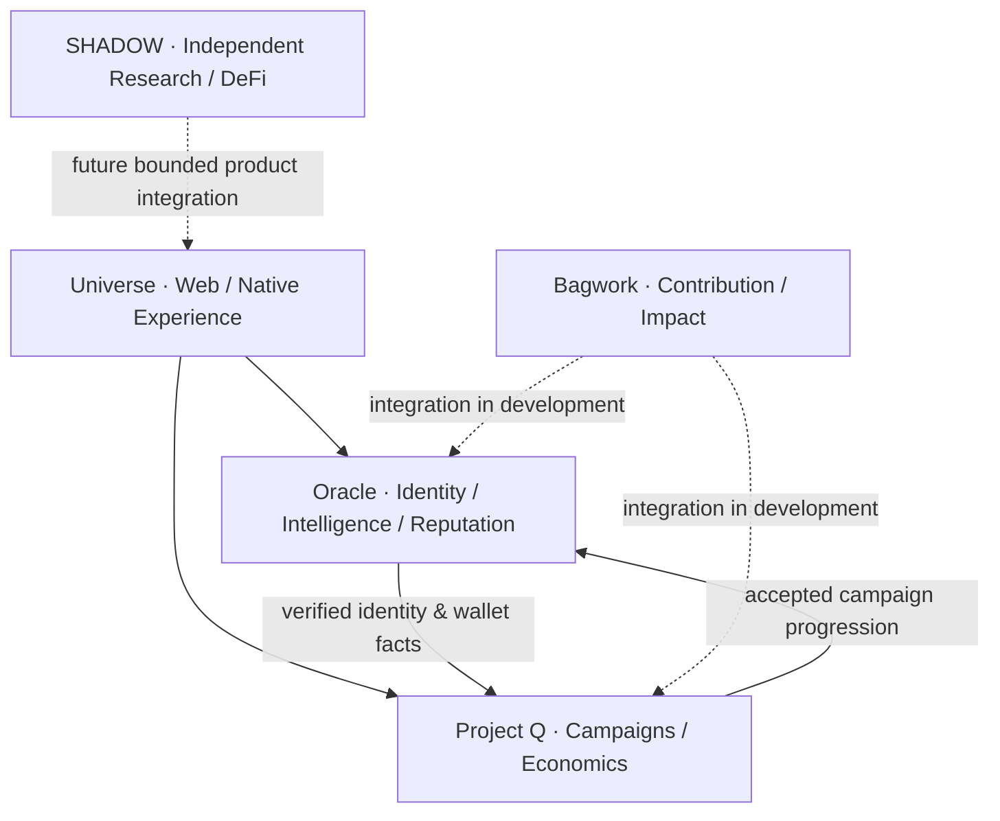

### Co-Founder of CrabStar · Technical Lead · Systems Builder

**Full-Stack Engineering · Systems Architecture · Solana / DeFi · AI Agents**

I architect and build connected systems spanning persistent identity, AI-powered intelligence, programmable on-chain economics, and web and native mobile applications.

From physical construction and mechanical systems to decentralized infrastructure, I bring a builder's mindset to complex technical problems: understand the whole system, engineer for reliability, and own the result.

[**CrabStar Ecosystem**](https://github.com/CrabStar-Ecosystem) · [**Engineering evidence**](ENGINEERING.md) · [**Runnable code**](examples/event-reconciliation/README.md)

## Technical leadership & development

I co-founded **CrabStar** and lead technical development across interconnected infrastructure and application projects. Founding development and collaborative development are credited distinctly.

| Project | Development responsibility | Public case study |
| --- | --- | --- |
| **Oracle** | **Founding Developer & Technical Lead** | [Identity & intelligence](https://github.com/darealrektrush/oracle-product-case-study) |
| **Project Q** | **Founding Developer & Technical Lead** | [Campaign economics & DeFi](case-studies/project-q.md) |
| **SHADOW** | **Founding Developer & Technical Lead**; collaborative development with [Andrew](https://github.com/Andrew-07) | [Solana intelligence](case-studies/shadow.md) |
| **Universe** | **Co-Founding Developer & Technical Lead**; collaborative development with [Andrew](https://github.com/Andrew-07) | [Web & native applications](case-studies/universe.md) |

## What I'm building

**CrabStar** is an interconnected ecosystem on Solana, designed to bring verified identity, participation, intelligence and economic coordination into reusable infrastructure. Its long-term mission is to create meaningful impact, beginning with **ocean conservation**.

My work spans **full-stack development, modular and distributed service architecture, APIs, data modeling, automation, AI-assisted engineering, Solana integrations, security boundaries, testing and operations**. The goal is to make independent products work together without duplicating ownership of identity, campaign state or financial decisions.

| System | Core infrastructure & capabilities | Explore |
| --- | --- | --- |
| **Oracle** | Persistent identity, Universal Profiles, reputation, AI-powered intelligence, Solana analytics, automation and ecosystem operations | [Case study](https://github.com/darealrektrush/oracle-product-case-study) |
| **Project Q** | Programmable campaigns, verified participation, on-chain/DeFi economic mechanics, token distributions, settlement coordination and economic receipts | [Case study](case-studies/project-q.md) |
| **SHADOW** | Solana wallet intelligence, quantitative research, token forensics, copyability analysis, AI-assisted agents and staged, policy-governed DeFi execution infrastructure | [Case study](case-studies/shadow.md) |
| **Universe** | Unified web/native mobile experiences integrating identity, intelligence, reputation, campaigns and economic infrastructure | [Case study](case-studies/universe.md) |

**Adjacent ecosystem work:** **Bagwork** connects contribution and impact through Oracle/Q integration work developed with external collaboration. Other areas include [Interface Lab](showcases/interface-lab.md), [REKTRUSH AI OS](showcases/rektrush-os.md), and [Revenue Operations](showcases/sustainable-operations.md).

**Development-stage note:** These descriptions cover implemented foundations and active product direction. They do not claim that every integration, on-chain financial operation or execution capability is live.

## FAWKQ — community utility & economic experimentation

**[FAWKQ ($FAWKQ)](https://fawkq.com/)** is a Solana ecosystem token rooted in **Bagwork**, community participation, and contribution-driven economics, with **Project Q's on-chain token distribution and reward coordination infrastructure** extending those mechanics. Its integration direction with **Oracle × Project Q** connects verified identity and wallet facts to campaign eligibility, programmable economics, distributions, and traceable settlement evidence.

FAWKQ is an early proving environment for CrabStar's wider participation and DeFi infrastructure. Individual integrations and financial workflows remain subject to their own implementation and verification stages.

**Network:** Solana Mainnet  
**Token mint address:** `GKnhgBgyYs8zPvteBoMXjt1Ew962tQYVU8gQztFdpump`  
**Verify:** [Solscan](https://solscan.io/token/GKnhgBgyYs8zPvteBoMXjt1Ew962tQYVU8gQztFdpump) · [Official FAWKQ site](https://fawkq.com/)

## Ecosystem architecture

A shared profile should remain consistent across products while each service retains responsibility for its own decisions.

*Conceptual authority and integration map, not a live deployment diagram. Dashed paths represent developing or future integrations. SHADOW's research and execution policy remains independent of community reputation and campaign economics.*

## Selected systems engineering

### Oracle — identity continuity and intelligence

Building canonical profiles, connection ownership and recovery, reputation, community operations and AI-assisted intelligence across Telegram and shared ecosystem APIs. **Engineering focus:** identity integrity, authenticated service boundaries, explainable data, recoverable workflows and operational observability.

### Project Q — economic correctness from participation to settlement

Developing campaign-specific evidence, eligibility and scoring, token-aware mechanics, allocation and release workflows, and verifiable receipts. **Engineering focus:** deterministic decisions, replay safety, authorization boundaries and distinguishing a recorded allocation from confirmed on-chain settlement. Strategic airdrops remain deferred.

### SHADOW — evidence before execution

Building wallet and token research pipelines, accounting-aware historical analysis, copyability evaluation, paper simulation and staged agentic infrastructure. **Engineering focus:** data provenance, missing-evidence handling, repeatability, independent risk gates and strict separation of intelligence from signing and live execution. No claim of live autonomous trading or demonstrated profitability.

### Universe — one experience, distinct authorities

Developing Next.js web and React Native/Expo native experiences that present Oracle identity and Project Q outcomes through shared contracts. **Engineering focus:** cross-client continuity, partial connection states, consistent representations of service data and secure application integration. Screens and integration journeys are validated separately from design prototypes.

## Inspectable engineering evidence

**[Event Reconciliation Lab — runnable Python code](examples/event-reconciliation/README.md)** demonstrates duplicate detection, conflicting-event rejection and order-independent reconciliation using synthetic fixtures. It includes **seven automated tests** and an example evaluating all **120 permutations** of a five-event input, without credentials or external dependencies.

[**Explore the engineering evidence index**](ENGINEERING.md) to see what the public examples and project case studies actually establish—and what still requires hosted or production verification.

The lab is educational, not production settlement code. Public documentation intentionally excludes secrets, privileged infrastructure, private member data and proprietary research details.

## Technology & engineering practice

| Discipline | Technologies and focus |
| --- | --- |
| **Backend & services** | Python, FastAPI, Node.js, Express, REST APIs, background and scheduled workers |
| **Web & native applications** | TypeScript, React, Next.js, React Native, Expo |
| **Solana / DeFi** | Solana Web3, wallet and token integration, on-chain data, economic and settlement boundaries |
| **Data & persistence** | PostgreSQL, Supabase, SQL, versioned migrations, integrity and replay-safe processing |
| **AI & automation** | LLM APIs, AI agents, tool-assisted workflows and evidence-grounded intelligence |
| **Infrastructure & delivery** | GitHub Actions, Render, CI/CD, environment separation, diagnostics and observability |
| **Identity & assurance** | OAuth, verified account ownership, authenticated service contracts, authorization, auditability and reconciliation |

**How I engineer:** separate domain authority, validate assumptions with tests, make incomplete states visible, isolate privileged actions, design for recoverability and treat deployment evidence as distinct from source-level correctness. AI agents accelerate research, implementation and review; I remain responsible for architecture, validation and operational outcomes.

Stacks, integration maturity and release status vary by project. The linked case studies distinguish source-level work, tests, active integration and verified deployments.

## A builder's mindset — from the trades to technology

My approach to engineering comes from **15 years in carpentry and the building industry**, including operating contracting businesses and managing complex residential projects, together with a lifelong hands-on background in building and mechanics.

I trained in carpentry at the **British Columbia Institute of Technology (BCIT)**, developing a practical foundation in structural principles, technical planning, precision and execution. Construction taught me to think in dependencies: understand the foundation, coordinate interconnected systems, anticipate failures and take responsibility for what gets built.

I also worked in **commercial crab fishing along British Columbia's coast**, where mechanical systems, equipment troubleshooting, adaptability and sound judgment matter in demanding conditions.

That experience carried into a genuine interest in decentralized markets and Solana, then into hands-on development of blockchain infrastructure, intelligent services and cross-platform applications. I continue developing my skills through building, studying emerging technologies and applying systems thinking across the full engineering lifecycle.

**Understand the system. Build with purpose. Solve real problems. Own the outcome.**

## Current development direction

- **Oracle × Project Q:** Validate shared identity, participation, wallet eligibility and economic receipt journeys across products.
- **Universe:** Bring verified Oracle and Q services into coherent web and native mobile experiences.
- **SHADOW:** Advance independent wallet discovery, research quality and controlled paper-evaluation infrastructure.
- **CrabStar ecosystem:** Apply proven integration contracts to contribution, game and other product experiences without duplicating core authorities.

These are current engineering priorities, not release dates, completed deployment claims or financial promises.

---

**Forged Below. Building Beyond.**  
*The Tide Rises Together.*

