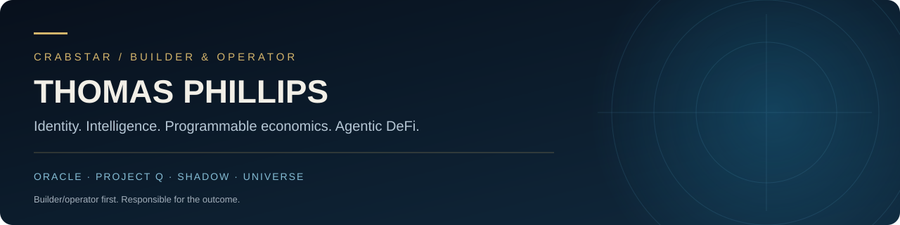
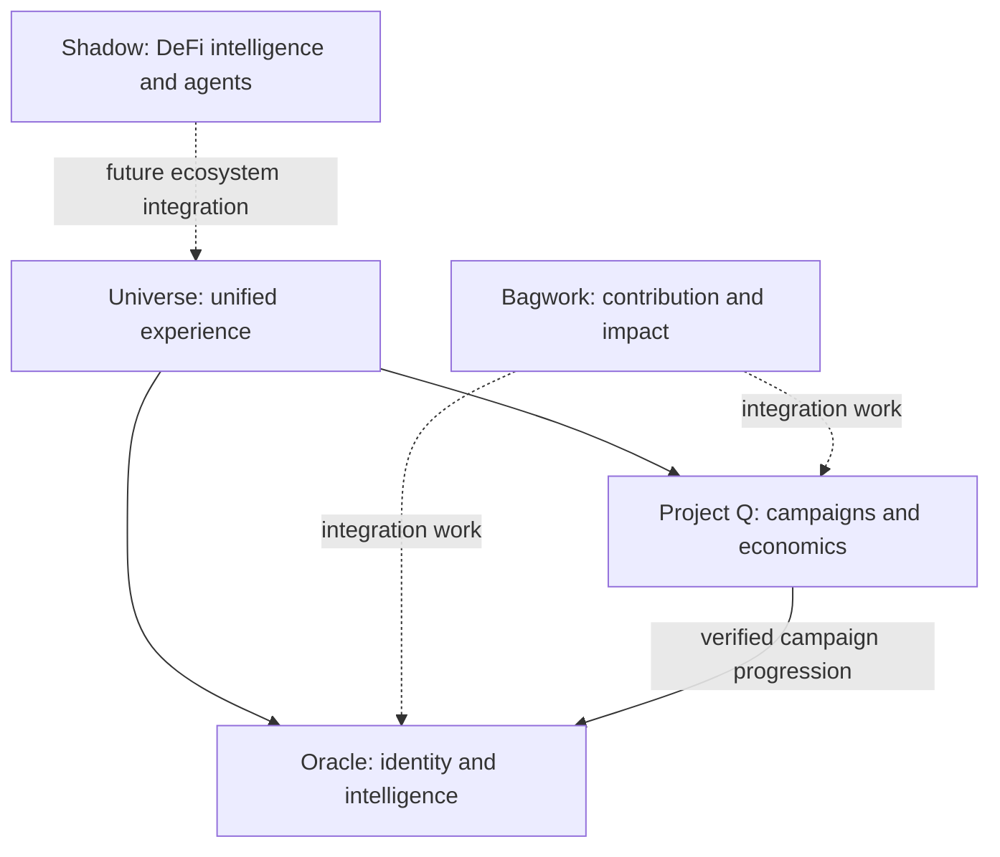

### Co-Founder of CrabStar · Technical Product Builder

**Building identity, intelligence, programmable economics and agentic DeFi infrastructure on Solana.**

[Oracle case study](https://github.com/darealrektrush/oracle-product-case-study) · [Project Q](showcases/project-q.md) · [Shadow](showcases/shadow.md) · [Universe](showcases/universe.md) · [X / Trench Intel](https://x.com/darealrektrush)

## What I'm building

CrabStar is a connected ecosystem where identity, contribution, intelligence and economic participation can work together. Its mission includes long-term impact, beginning with ocean conservation.

My work spans product definition, architecture, interface design, AI-assisted implementation, testing, deployment and operations. I use AI agents to accelerate delivery while owning the decisions, verification and outcomes.

| System | Role | Public overview |
| --- | --- | --- |
| **Oracle** | Persistent identity, intelligence, reputation and community operations | [Product case study](https://github.com/darealrektrush/oracle-product-case-study) |
| **Project Q** | Reusable campaigns, participation and economic coordination | [Engineering showcase](showcases/project-q.md) |
| **Shadow** | Solana intelligence, quantitative research and staged agentic DeFi infrastructure | [Engineering showcase](showcases/shadow.md) |
| **Universe** | Unified web and native mobile experience for the ecosystem | [Product and architecture](showcases/universe.md) |
| **Bagwork** | Contribution and impact platform connected through shared services | Oracle/Q integration work; platform built with external collaboration |
| **FAWKQ** | Testing and activation asset for campaign and economic experiments | A proving environment for the broader build |

## How the systems fit together

The architecture separates responsibilities so products can share capabilities without duplicating authority.

This is a product relationship map, not a live deployment diagram. Dashed relationships represent development or future integration.

## Selected engineering work

**Oracle — continuity across products.** The build connects profiles, account ownership, participation, reputation, intelligence and support workflows. Its expansion carries that foundation beyond Telegram into shared ecosystem services.

**Project Q — participation with traceable outcomes.** Campaign scoring and economic coordination are separate from permanent identity. The build includes campaign logic, economic modules, contribution integration and receipt/reconciliation work.

**Shadow — evidence before execution.** Wallet histories, token-risk evidence, copyability research and auditable analysis form the intelligence foundation. Simulation and policy-bound execution are staged development areas; research output is not proof of live trading or profitability.

**Universe — one ecosystem across clients.** The application direction combines a Next.js web experience with React Native/Expo mobile clients using shared Oracle and Q contracts.

## Engineering priorities

| Concern | How it shapes the work |
| --- | --- |
| Data integrity | Explicit ownership, attributable events and controlled retries |
| Intelligence quality | Freshness, incomplete-data states and explainable evidence |
| Reliability | Recoverable workflows, diagnostics and operational verification |
| Financial workflows | Separate calculation, authorization, execution and reconciliation |
| Product experience | Clear next actions, mobile usability and understandable receipts |
| Sustainable operation | Bounded provider usage, cost awareness and maintainable services |

## Technology across the builds

**Backend:** Python · FastAPI · Node.js · Express  
**Applications:** React · Next.js · TypeScript · React Native · Expo  
**Data:** PostgreSQL · Supabase · versioned migrations  
**Integrations:** Telegram · OAuth · Solana · market-data providers · AI APIs  
**Delivery:** GitHub Actions · Render · automated checks · operational diagnostics

Stacks vary by project. Planned client platforms and active integrations are distinguished in the individual showcases.

## Current direction

- Validate shared identity and campaign journeys across Oracle, Q and Bagwork.
- Use FAWKQ experiments to test mechanics before broader CrabStar programs.
- Advance Shadow's intelligence and controlled research infrastructure toward its MVP.
- Bring proven shared services into Universe's web and native mobile experience.

These are development priorities, not release-date or commercial-availability promises.

## Builder/operator first

My background in carpentry, contracting and commercial fishing shapes how I build: understand the constraints, make the decisions, deliver useful work and remain accountable for it.

The public material here shows product thinking and selected engineering evidence. Sensitive implementation, operating configuration and private user data remain outside the showcases.

**Built below. Forged in the trenches.**
