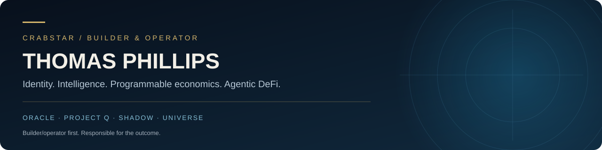
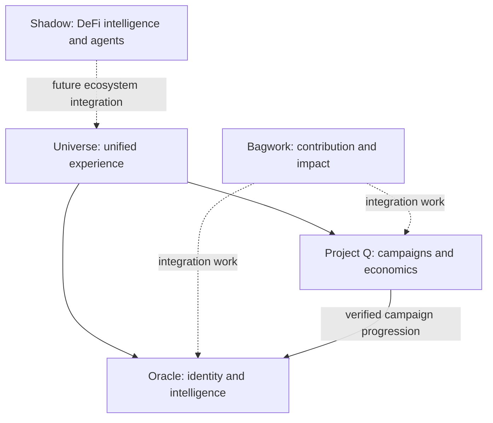

### Co-Founder of CrabStar · Technical Lead · Systems Builder

**AI Agents · Solana · Blockchain Infrastructure**

From building in the physical world to engineering connected digital systems. I lead development across identity, intelligence, on-chain/DeFi economics, and web/native experiences—with a focus on architecture, verification, and meaningful utility.

## Selected work

**Four connected systems. Distinct responsibilities. Shared foundations.** The public case studies document the product problems, architecture, engineering tradeoffs and current evidence boundaries—not just screenshots or feature lists.

| Project | Development | Focus |
| --- | --- | --- |
| **[Oracle](https://github.com/darealrektrush/oracle-product-case-study)** | Founding developer | Persistent identity, intelligence and community operations |
| **[Project Q](case-studies/project-q.md)** | Founding developer | Verified participation, on-chain/DeFi mechanics and programmable campaign economics |
| **[Shadow](case-studies/shadow.md)** | Lead developer; collaborative with [Andrew](https://github.com/Andrew-07) | Solana intelligence and staged agentic DeFi |
| **[Universe](case-studies/universe.md)** | Lead developer; collaborative with [Andrew](https://github.com/Andrew-07) | Connected web and native mobile experiences |

**[CrabStar Ecosystem](https://github.com/CrabStar-Ecosystem)** · Shared projects, individual contributions.

[**Inspect working code**](examples/event-reconciliation/README.md) · [Engineering evidence](ENGINEERING.md) · [X / Trench Intel](https://x.com/darealrektrush)

## What I'm building

As Co-Founder and Technical Lead of **CrabStar**, I'm building a connected ecosystem of decentralized infrastructure, intelligent applications, and on-chain economic systems on **Solana**. Our vision brings persistent identity, verified participation, reputation, blockchain intelligence, and programmable DeFi mechanics together through interoperable services and applications—with a long-term mission of creating meaningful impact, beginning with ocean conservation.

My work spans **full-stack software engineering, distributed systems architecture, blockchain infrastructure, API and service development, database design, automation, and AI-powered intelligence systems**. I design and develop the infrastructure connecting Oracle, Project Q, SHADOW, and Universe—from canonical identity and data models to on-chain integrations, economic coordination, backend services, and web and native mobile experiences.

I take a hands-on approach across the entire engineering lifecycle: **system architecture, technical design, implementation, integration, security, testing, deployment, observability, and production operations**. I leverage AI agents and modern development tools to accelerate research, engineering, and iteration while maintaining direct responsibility for architectural decisions, code quality, verification, and operational reliability.

My focus is on building **scalable, secure, modular, and interoperable systems** that solve real problems, support sustainable decentralized economies, and provide a foundation for long-term ecosystem growth.

| System | Role | Public overview |
| --- | --- | --- |
| **Oracle** | Persistent identity, intelligence, reputation and community operations | [Product case study](https://github.com/darealrektrush/oracle-product-case-study) |
| **Project Q** | Verified participation, on-chain/DeFi mechanics and campaign economics | [Product case study](case-studies/project-q.md) |
| **Shadow** | Solana intelligence, quantitative research and staged agentic DeFi infrastructure | [Product case study](case-studies/shadow.md) |
| **Universe** | Unified web and native mobile experience for the ecosystem | [Product case study](case-studies/universe.md) |
| **Bagwork** | Contribution and impact platform connected through shared services | Oracle/Q integration work; platform built with external collaboration |
| **Interface Lab** | Oracle intelligence terminal interface prototype | [Design and engineering](showcases/interface-lab.md) |
| **REKTRUSH AI OS** | Private operator workspace for intelligence and governed agent workflows | [Engineering showcase](showcases/rektrush-os.md) |
| **Revenue Operations** | Sustainable operating models for Oracle infrastructure | [Public overview](showcases/sustainable-operations.md) |
| **FAWKQ** | Testing and activation asset for campaign and economic experiments | A proving environment for the broader build |

## How the systems fit together

The architecture separates responsibilities so products can share capabilities without duplicating authority.

This is a product relationship map, not a live deployment diagram. Dashed relationships represent development or future integration.

## Selected engineering work

**Oracle — continuity across products.** The build connects profiles, account ownership, participation, reputation, intelligence and support workflows. Its expansion carries that foundation beyond Telegram into shared ecosystem services.

**Project Q — participation with traceable outcomes.** Campaign scoring and economic coordination are separate from permanent identity. The build includes campaign logic, on-chain/DeFi economic modules, token distribution and burn workflows, contribution integration, and receipt/reconciliation work. Development scope is not a claim that every financial workflow is live.

**Shadow — evidence before execution.** Wallet histories, token-risk evidence, copyability research and auditable analysis form the intelligence foundation. Simulation and policy-bound execution are staged development areas; research output is not proof of live trading or profitability.

**Universe — one ecosystem across clients.** The application direction combines a Next.js web experience with React Native/Expo mobile clients using shared Oracle and Q contracts.

## Runnable engineering example

[**Event Reconciliation Lab**](examples/event-reconciliation/README.md) — an offline Python example demonstrating duplicate handling, conflicting-event rejection and order-independent reconciliation. Includes synthetic fixtures and seven executable tests; no credentials or dependencies required.

This standalone educational example illustrates an engineering concern without exposing production implementation.

## Engineering priorities

| Concern | How it shapes the work |
| --- | --- |
| Data integrity | Explicit ownership, attributable events and controlled retries |
| Intelligence quality | Freshness, incomplete-data states and explainable evidence |
| Reliability | Recoverable workflows, diagnostics and operational verification |
| Financial workflows | Separate calculation, authorization, execution and reconciliation |
| Product experience | Clear next actions, mobile usability and understandable receipts |
| Sustainable operation | Bounded provider usage, cost awareness and maintainable services |

## Technology across the builds

**Backend:** Python · FastAPI · Node.js · Express  
**Applications:** React · Next.js · TypeScript · React Native · Expo  
**Data:** PostgreSQL · Supabase · versioned migrations  
**Integrations:** Telegram · OAuth · Solana · market-data providers · AI APIs  
**Delivery:** GitHub Actions · Render · automated checks · operational diagnostics

Stacks vary by project. Planned client platforms and active integrations are distinguished in the individual showcases.

## Current direction

- Validate shared identity and campaign journeys across Oracle, Q and Bagwork.
- Use FAWKQ experiments to test mechanics before broader CrabStar programs.
- Advance Shadow's intelligence and controlled research infrastructure toward its MVP.
- Bring proven shared services into Universe's web and native mobile experience.

These are development priorities, not release-date or commercial-availability promises.

## A Builder's Mindset. From the Trades to Technology.

My approach to software engineering is rooted in 15 years of experience in carpentry and the building industry, including running contracting businesses and managing complex residential projects. Combined with a lifelong hands-on background in building and mechanics, that experience shaped how I approach technical challenges, system design, and problem-solving.

Trained in carpentry at the **British Columbia Institute of Technology (BCIT)**, I developed a foundation in technical planning, structural principles, precision, and practical execution. Working in construction taught me to understand how individual components fit into larger systems, anticipate problems before they become failures, and take responsibility for the finished product.

My background also includes commercial crab fishing along British Columbia’s coast, where working with mechanical systems and equipment in demanding conditions required hands-on engineering, technical problem-solving, adaptability, sound judgment, and reliability.

That same builder's mentality now drives my work in **software engineering, blockchain infrastructure, and decentralized systems**. What began as a genuine interest in decentralized markets, particularly the Solana ecosystem, evolved into hands-on development of interconnected products spanning identity, intelligence, automation, DeFi economics, and web and mobile applications.

I continue expanding my technical knowledge through practical development, systems architecture, emerging technologies, and AI-assisted engineering—applying the same principles that have guided my work throughout the trades: **understand the system, build with purpose, solve real problems, and take ownership of the outcome.**

The public material here shows product thinking and selected engineering evidence. Sensitive implementation, operating configuration and private user data remain outside the showcases.

**Forged Below. Building Beyond.**  
*The Tide Rises Together.*
