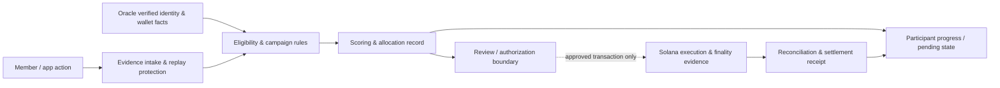
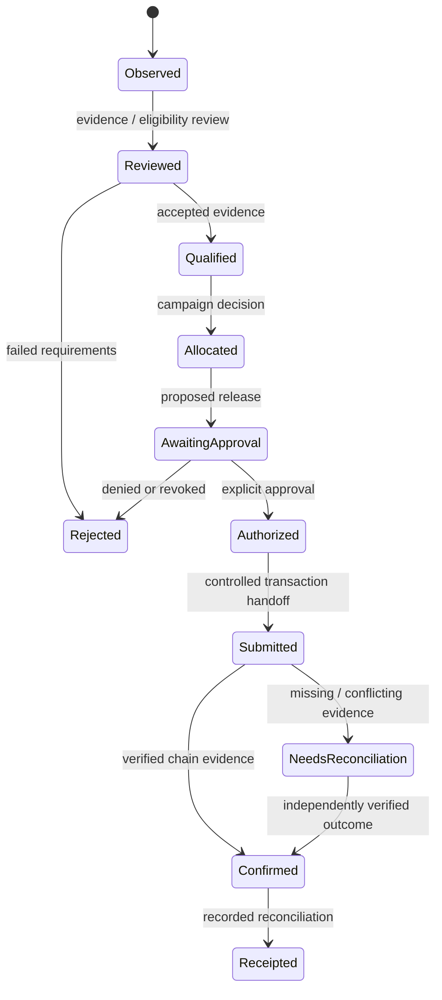

# Project Q
### Verified participation · Campaign economics · On-chain / DeFi infrastructure

**Founding Developer & Technical Lead:** [Thomas Phillips](https://github.com/darealrektrush)

[← Engineering portfolio](../README.md) · [CrabStar Ecosystem](https://github.com/CrabStar-Ecosystem) · [Original engineering showcase](../showcases/project-q.md)

> **Public engineering case study.** Q is an active build. A capability implemented in source or tested in isolation is not automatically deployed, enabled, funded or verified end-to-end. Strategic airdrops remain deferred.

## Executive summary

Project Q is the reusable participation and economic coordination engine for CrabStar. It is designed to let campaigns define what qualifies, what members earn, which asset or economic mechanic applies, and what evidence proves an outcome—all without recreating identity or embedding payout authority in social interactions.

It spans Telegram-based campaigns, verified participation, eligibility, scoring, on-chain/DeFi rules, allocation and settlement records, and integration with ecosystem applications such as Universe and Bagwork.

## The problem

Community campaigns often start as messages, spreadsheets and manual transfers. Once a program crosses multiple products, wallets and assets, that approach becomes difficult to audit. Duplicate actions, missing identity evidence, partial settlement and inaccurate reward displays become real operational risks.

**The engineering goal:** turn social participation and on-chain facts into reproducible campaign decisions, then make the distinction between *earned*, *allocated*, *authorized*, *submitted* and *confirmed* understandable to participants and operators.

## System responsibilities

| Layer | Owner | Responsibility |
| --- | --- | --- |
| Permanent identity, linked accounts and wallets | **Oracle** | Verified identity facts and lifetime Crab Army progression |
| Campaign definitions, eligibility and scoring | **Project Q** | Campaign-specific rules, evidence and decisions |
| Economic mechanics | **Project Q** | Allocation, release, distributions, burns and settlement coordination |
| Financial authorization and chain evidence | **Restricted execution boundary** | Explicit approvals, transactions, finality and reconciliation |
| Member experiences | **Telegram / Universe / connected apps** | Progress, outcomes, actionable status and receipts |

*Conceptual authority diagram—not a claim that every path is live.*

## On-chain and DeFi mechanics

The product scope is broader than simple social rewards:

- **Token-aware eligibility:** applicable wallet ownership and holdings evidence, including Solana token-program identity, with campaign-specific requirements.
- **Multiple asset paths:** staged SPL / Token-2022 / USDC economic workflows, subject to the exact implementation and release state.
- **Distributions:** reproducible allocation decisions, controlled approval/execution boundaries, confirmation and discrepancy handling.
- **Burn and release logic:** explicit economic rules and records that distinguish a planned action from an executed on-chain result.
- **Holding checkpoints and corrections:** point-in-time eligibility/holding evidence and attributable corrections rather than silent history rewrites.
- **Receipts:** records linking campaign decisions to verifiable settlement evidence where applicable.

**Not yet claimed:** complete live on-chain automation across every asset, universal settlement availability, or strategic airdrops.

## Representative engineering scenario

A member submits the same qualifying action twice. Their campaign allocation is calculated, but no confirmed on-chain payment has been observed.

The correct user experience is **one eligible event**, **one attributable allocation**, and a **pending/unsettled** financial state—not two rewards or a fictional transaction receipt. Retry and reconciliation paths must converge without double credit.

## Design tradeoffs

| Decision | Benefit | Complexity introduced |
| --- | --- | --- |
| Keep Oracle as canonical identity authority | Reusable participation across products | Cross-service claim and ownership validation |
| Separate campaign scoring from transfers | Financial safety and auditability | Multiple explicit lifecycle states |
| Store attributable economic evidence | Reconciliation and dispute handling | More durable records and correction workflows |
| Require verifiable chain settlement | Honest outcome reporting | Provider errors, finality and replay management |
| Keep token mechanisms campaign-scoped | Reusable multi-asset infrastructure | Config validation and security review |

## Engineering implementation and integration boundaries

Project Q is designed as a **reusable campaign engine**, not a separate identity service or a set of one-off payment scripts. The private codebase contains a Node.js/Express service, a Telegram campaign application, database migrations, economic modules and automated tests. The engineering work separates the following concerns:

| Boundary | Input | Responsibility | Output |
| --- | --- | --- | --- |
| **Participation intake** | Social actions, campaign events and contribution evidence | Attribute events, apply review/replay rules and preserve evidence | Campaign-scoped observations |
| **Identity and eligibility** | Oracle-verified profile, connections and wallet claims | Evaluate campaign requirements without creating a second identity authority | Eligibility decision with attributable inputs |
| **Campaign accounting** | Qualified events, rule versions and asset-specific terms | Determine scoring, allocation and release state | Reproducible campaign records |
| **Financial control** | Proposed distribution or burn | Require distinct review and authorization before state-changing actions | Approved, rejected or pending instruction |
| **On-chain evidence** | Transaction reference, status and finality | Distinguish submitted actions from observed settlement | Reconciled result and receipt |
| **Ecosystem presentation** | Authorized campaign and settlement projections | Communicate progress to Telegram and future clients | Clear member/operator status |

These are *logical boundaries*. They do not certify that each boundary is independently deployed or that every integrated financial path has passed acceptance.

### State transitions: decision is not settlement

*Illustrative lifecycle model. Actual state names, transitions and release permissions must be reconciled to the specific implementation; this is not an assertion that all paths are live.*

### Three engineering decisions worth examining

1. **Identity should be reused, not duplicated.** Oracle owns canonical member identity, verified account/wallet connections and lifetime progression. Q consumes verified facts but remains authoritative for campaign-scoped eligibility and economics.
2. **Financial actions cannot be inferred from engagement.** A successful social action or allocation calculation does not approve a transfer. Distribution authority, chain submission, finality evidence and participant receipts must remain separately verifiable.
3. **Corrections should be attributable.** Duplicate event delivery, referral revocation, holding changes and incomplete chain evidence require explicit review/replay behavior rather than silently rewriting participant history.

## Verification and release evidence

A case study is credible when readers can distinguish **design intent**, **source-level work**, **automated checks** and **genuine environment acceptance**.

| What can be described | What it establishes | What it does **not** establish |
| --- | --- | --- |
| Private campaign code and migration history | Implemented data and service structures at reviewed revisions | The exact schema is deployed in every environment |
| Automated unit / contract checks | Selected deterministic rules and boundary behavior | Real provider, wallet or operator acceptance |
| Isolated economic and on-chain rehearsals | Evidence about specific scenarios under test conditions | Permission to distribute real funds |
| Verified transaction evidence and reconciliation records | Settlement of the particular referenced operation | Complete deployment readiness of every campaign mechanism |
| Public [Event Reconciliation Lab](../examples/event-reconciliation/README.md) | Inspectable handling of duplicate and out-of-order synthetic events | Project Q production code or on-chain finality |

### Acceptance questions before calling an economic journey complete

- Does the same verified member resolve to one canonical Oracle profile across Telegram and other clients?
- Can repeated participation evidence be retried without duplicating credit or allocation?
- Are campaign eligibility, wallet ownership and token holdings evaluated against the correct point in time?
- Can a financial action be rejected or left pending without falsely reporting payment?
- Can an operator trace an approved distribution from campaign decision through transaction evidence and participant receipt?
- Are secrets, signing privileges and production funds isolated from development and rehearsal environments?

These are **qualification criteria**, not a claim that every check has already passed. Specific release records and environment evidence determine the answer.

## Engineering substance

The private implementation spans Node.js / Express, Telegram campaign experiences, PostgreSQL / Supabase migrations, Solana integrations and automated checks. Recent development areas include identity integration, referral and participation evidence, holding projections, transaction boundary isolation, and on-chain economic foundations.

Source-level code and individual CI checks establish **engineering progress**. Genuine Dev acceptance, migrations, operator approvals, external wallet behavior and settlement verification require separately recorded evidence.

## My role

As **founding developer and technical lead**, I work across product definition, campaign/economic architecture, service boundaries, implementation, security controls, integration review and release verification. The focus is to make economic participation useful, understandable and independently auditable.

## Current stage and publication boundary

**Status: active development and integration.** FAWKQ has served as a proving environment for campaign mechanics. Future campaigns and economic operations require their own authorization and live verification.

This public document intentionally excludes privileged payout procedures, campaign budgets, private account data, production configuration and unreleased operational details.

**Participation with purpose. Outcomes with evidence.**
