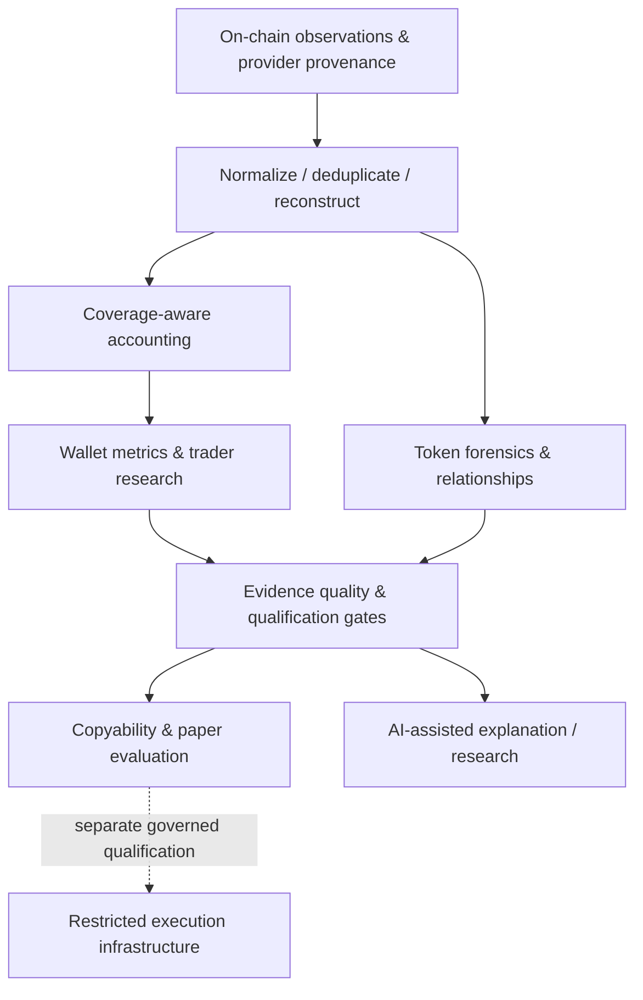

# SHADOW
### Solana intelligence · Wallet research · Evidence-led agentic DeFi

**Founding developer & technical lead:** [Thomas Phillips](https://github.com/darealrektrush)  
**Collaborative developers:** [Thomas Phillips](https://github.com/darealrektrush) & [Andrew](https://github.com/Andrew-07)

[← Engineering portfolio](../README.md) · [CrabStar Ecosystem](https://github.com/CrabStar-Ecosystem) · [Original engineering showcase](../showcases/shadow.md)

> **Public engineering case study.** This describes implementation and research architecture, not proven investment performance, a live trading service, or unrestricted autonomous execution.

## Executive summary

SHADOW is an independent Solana intelligence and research platform intended to identify repeatable on-chain behavior, investigate wallet quality, assess token and execution risk, and test hypotheses before capital is ever involved.

It combines historical data ingestion, accounting-aware wallet analysis, token forensics, relationship research, copyability studies, paper evaluation, governed AI-assisted workflows and separately controlled execution concepts.

## The problem

A profitable-looking wallet is not necessarily a profitable strategy. A limited sample can exclude losses; related wallets can distort apparent consensus; a trade can become uncopyable once slippage, liquidity, fees, latency and execution constraints are considered.

The product must answer multiple questions independently: **What happened? How complete is the evidence? Is the behavior repeatable? Could another actor reproduce it? What would invalidate the conclusion?**

## Evidence pipeline

*Research architecture; dashed execution transition is not proof of deployed signing or trading.*

## Capabilities and evidence rules

| Domain | Engineering question | Guardrail |
| --- | --- | --- |
| Wallet history | Is observed P&L based on reliable reconstruction? | Missing balances, unmatched activity and data gaps stay visible |
| Trader quality | Is performance repeatable across meaningful windows? | Sample-size and qualification gates |
| Copyability | Would timing, costs and liquidity erase an apparent edge? | Point-in-time quotes and explicit unknowns |
| Token forensics | What risk signals are supported by chain facts? | Facts separated from heuristic flags |
| Relationships & clusters | Are wallets independent or possibly coordinated? | Correlation is not proof of common ownership |
| Paper research | Would a proposed method survive realistic assumptions? | No custody or live orders |
| Agentic workflows | Can AI assist investigation and explanation? | AI cannot override deterministic controls |
| Restricted execution | What evidence and approvals would be required? | Signing, authorization and reconciliation isolated |

## Representative engineering scenario

Historical records suggest a wallet has a strong win rate. A deeper replay finds a large unexplained token-balance decrease and incomplete accounting coverage. The result must be labeled **not yet qualified**, regardless of how attractive the headline metric looks.

Research then preserves data provenance, searches for missing events, reruns deterministic accounting, and only revisits qualification after the gap is explained or explicitly bounded.

## Architecture decisions

- **Independent research authority:** ecosystem rank, token holdings and community reputation do not change market evidence or trading privileges.
- **Reproducible data:** capture source provenance, analysis versions, coverage and immutable evidence where appropriate.
- **Conservative classification:** distinguish unavailable, incomplete, preliminary and qualified findings.
- **Separation of duties:** research output, paper simulation, authorization, signing and finality accounting remain different concerns.
- **Cost discipline:** bounded archival requests, checkpointed backfills and provider-aware workload control.
- **Governed AI:** agents may assist investigation and explanations without silently changing scoring or risk policy.

## Implementation footprint

The private codebase contains Python APIs and workers, PostgreSQL-backed research state, checkpointed ingestion and analysis, wallet and token intelligence, paper evaluation, and staged authorization/outcome modules. The presence of a module or passing unit test is not a claim that a dependent signer, deployment, financial service or complete trading strategy has been validated.

## My development role

As SHADOW's founding developer and technical lead, I drive the technical direction, core architecture, research and intelligence systems, implementation and verification strategy. SHADOW is a **collaborative build with Andrew**, with both developers credited for their contributions.

## Current stage

**Status: research and staged engineering development.** A major focus is robust wallet discovery and deterministic accounting before broader strategy evaluation. Live performance, profitability and production execution are **not claimed**.

The publication excludes proprietary strategy thresholds, privileged operational protocols, signing details, sensitive portfolio records and private provider configuration.

**Evidence first. Conviction earned.**
