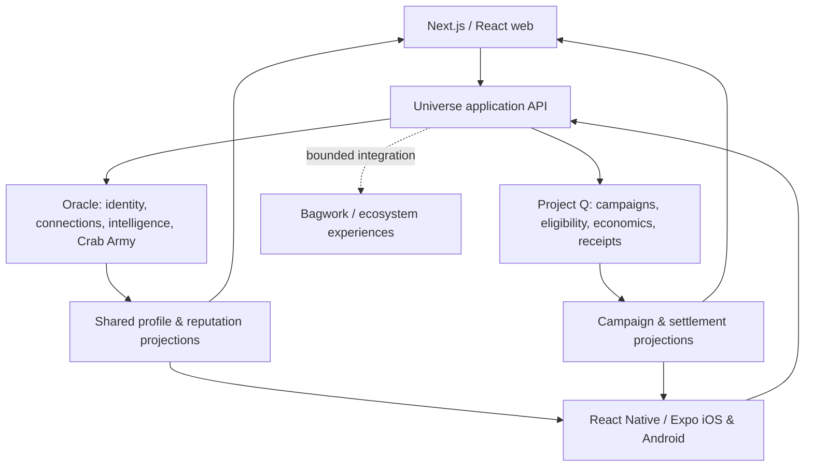

# CrabStar Universe
### One ecosystem · Web and native mobile · Shared identity

**Co-founding developer & technical lead:** [Thomas Phillips](https://github.com/darealrektrush)  
**Collaborative developers:** [Thomas Phillips](https://github.com/darealrektrush) & [Andrew](https://github.com/Andrew-07)

[← Engineering portfolio](../README.md) · [CrabStar Ecosystem](https://github.com/CrabStar-Ecosystem) · [Original engineering showcase](../showcases/universe.md)

> **Public product and engineering case study.** Figma design, code in a repository, integration acceptance and production/mobile-store availability are separate milestones.

## Executive summary

CrabStar Universe is the connected web and native mobile experience for the CrabStar ecosystem. The goal is a coherent product where members can enter once, claim a persistent identity, understand their Crab Army reputation, discover experiences and follow verified participation and economic outcomes.

Universe is the **experience layer**. Oracle owns canonical identity, verified connections, intelligence and reputation; Project Q owns campaign eligibility, scoring, on-chain/DeFi economic mechanics and settlement records.

## The problem

A growing ecosystem can quickly become a fragmented collection of Telegram flows, campaign apps, dashboards and disconnected profiles. Members should not need to create duplicate identities or guess whether the rewards shown in one interface agree with another.

The challenge is to make one continuity layer work across products and devices **without moving domain authority into the client**.

## Product and service architecture

*Conceptual service responsibilities; not a fully verified deployment diagram.*

## Core experience pillars

| Experience | Member benefit | Source of truth |
| --- | --- | --- |
| Ecosystem entry | Progressive onboarding and existing-profile claiming | Oracle |
| Universal Profile | Identity, linked accounts, wallets and durable history | Oracle |
| Crab Army | XP, ranks, contribution and recognition | Oracle |
| Oracle intelligence | Contextual questions, community and market intelligence | Oracle |
| Project Q campaigns | Participation, eligibility, missions and progress | Project Q |
| On-chain economic outcomes | Clear reward, pending, settled and receipt states | Project Q / verified chain evidence |
| Ecosystem discovery | Access to connected products and contribution opportunities | Bounded product integrations |

## Representative design scenario

An existing Telegram member signs into Universe on a new device, links a wallet and enters a campaign.

The app should **claim the existing Oracle profile**, preserve their earlier XP and history, reflect partial verification honestly, show campaign eligibility from Q, and avoid displaying an allocation as paid before chain evidence confirms settlement.

The experience may look unified; its trust boundaries remain explicit.

## Architecture and interface decisions

- **One profile, not one database per app:** Oracle remains the canonical authority.
- **Client-specific experience:** web/desktop and native mobile can differ in navigation and interaction while sharing validated service contracts.
- **Progressive connections:** additional Telegram, X and Solana proofs are requested when a feature needs them.
- **Honest async states:** loading, missing proof, errors, pending rewards and confirmed results receive distinct UI treatments.
- **Secure service integration:** privileged credentials, wallet assertions and financial controls stay server-side.
- **Design-to-build verification:** Figma layouts, component implementation and real integration paths must be evaluated separately.

## Engineering footprint

The private Universe repository includes a **Next.js / React web application**, an **Express / TypeScript server** and a **React Native / Expo mobile client**, together with architecture specifications and mobile preview/visual-QA workflows.

The current design program includes continued work on screen structure, UX and Figma layouts. These evolving artifacts are **design evidence**, not proof that each screen is implemented or that an app is available in public stores.

## My development role

As a co-founding developer and technical lead, I drive Universe's technical architecture, application and integration development, product-system decisions and implementation quality. Universe is a **collaborative build with Andrew**, with both developers credited for their contributions.

## Current stage

**Status: active product design, application development and integration.** The shared Oracle × Project Q experience requires exact, environment-specific verification before broad release claims. Store publication and completed end-to-end member journeys are not asserted here.

Public information intentionally excludes private deployment configuration, unreleased access and recovery procedures, and identifiable member records.

**One identity. One ecosystem. Multiple clients.**
