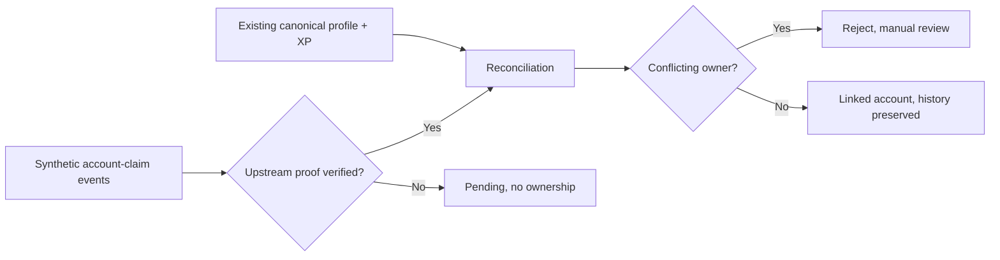

# Universal Profile Reconciliation Lab

**Runnable engineering example · Synthetic identities · Python standard library**

This is a standalone educational demonstration of how an identity platform can preserve an existing canonical member profile while adding verified external account connections.

The design relates to Oracle's Universal Profile direction, but **does not contain Oracle source code, actual authentication, identity-provider integrations, wallet ownership verification, or private user records**.

## Run locally

From the repository root (Python 3.12+):

```bash
python examples/identity-reconciliation/reconcile.py
python -m unittest discover -s examples/identity-reconciliation -p 'test_*.py' -v
```

There are **12 automated tests**. No network, packages or credentials are required.

## Problem and design

Members may already have an Oracle profile with historical XP and participation. A new Google, Apple, Telegram, X or Solana wallet connection should be attached *only after ownership proof*, without creating a second permanent identity or losing valid history.



### Invariants demonstrated

| Input / condition | Model behavior |
| --- | --- |
| New verified account on existing profile | Link connection; retain canonical profile ID and XP |
| Unverified wallet or social claim | Remain pending, with no ownership assigned |
| Same event delivered repeatedly | Deduplicate without creating extra connections |
| Event ID reused with different payload | Reject the entire batch |
| Same verified external account assigned to two profile IDs | Reject the batch; manual review required |
| Multiple verified connections for one member | One canonical profile remains |
| Events arrive in different orders | Deterministic final snapshot |
| Unknown canonical profile | Reject; no profile is created implicitly |

**Important:** `proof_verified=True` is a *synthetic input fixture*. This program assumes an external system has already verified account or wallet ownership; it neither checks an OAuth assertion nor proves control of a Solana key. A caller cannot securely establish ownership by submitting a boolean in a real service.

## Trust boundary and limitations

- No automatic account merging or profile creation.
- No connection removal, rotation, recovery, revocation history or proof expiration.
- No persistent database, concurrency, authentication, authorization, rate limiting or event signatures.
- No claim that this is Oracle's production algorithm or API.
- A deployed system would require verified provider proofs, trusted upstream authorization, canonical constraints, transactional persistence, audit history, replay protection and formal human-review workflows.

[Back to engineering evidence](../../ENGINEERING.md) · [Back to the personal profile](../../README.md)
