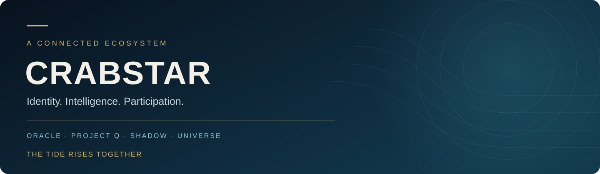

### Identity. Intelligence. Participation.

Building connected infrastructure on Solana, with a mission that begins with the ocean.

[**Explore CrabStar**](https://crabstar.io) · [Community](https://t.me/crabstarofficial) · [Updates](https://x.com/CrabStar_io)

## One ecosystem. Shared foundations.

CrabStar brings identity, intelligence, campaign economics and connected experiences into a common ecosystem. Each product has a distinct responsibility, with shared foundations designed to let the work grow together.

| System | Purpose | Development |
| --- | --- | --- |
| **Oracle** | Persistent identity, intelligence, reputation and community operations | Founding developer: [Thomas Phillips](https://github.com/darealrektrush) |
| **Project Q** | Campaign infrastructure, verified participation and economic coordination | Founding developer: [Thomas Phillips](https://github.com/darealrektrush) |
| **SHADOW** | Solana intelligence, wallet research and staged agentic DeFi infrastructure | Developed collaboratively by the CrabStar team |
| **Universe** | A connected web and native mobile experience for the ecosystem | Developed collaboratively by the CrabStar team |

**FAWKQ** supports ecosystem activation and participation experiments. **Revenue Operations** explores sustainable operating models for the infrastructure behind the products.

## Built with intent

**Connected by design.** Shared identity and clear product responsibilities guide the architecture.

**Evidence before claims.** We distinguish implemented behavior from prototypes, research and future development.

**Accountability in the build.** Individual contributions retain their authorship. Collaborative work is credited to the people who make it possible.

**Impact beyond the screen.** Our long-term mission begins with ocean conservation and the communities connected to it.

## Explore the engineering

Core implementation repositories are private. Public engineering material offers a closer look at the product thinking, architecture and selected examples.

- **[Oracle product case study](https://github.com/darealrektrush/oracle-product-case-study)** — identity, intelligence and ecosystem operations.
- **[Engineering portfolio](https://github.com/darealrektrush)** — project showcases, architecture and runnable examples.

## Building the next tide

Our development direction connects Oracle's identity and intelligence with Project Q's campaign infrastructure, advances SHADOW's research and governed execution foundations, and brings shared capabilities into Universe.

Products and integrations are at different stages of development. This profile describes the ecosystem's direction; it is not a statement that every capability is publicly available.

---

**The Tide Rises Together.**

[crabstar.io](https://crabstar.io) · [@CrabStar_io](https://x.com/CrabStar_io) · [Join the community](https://t.me/crabstarofficial)

