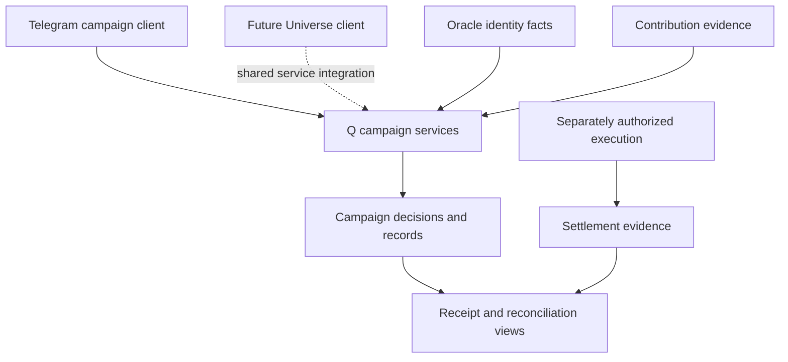

# Project Q

### Participation and programmable economic coordination

[Back to the ecosystem](../README.md) · [Oracle case study](https://github.com/darealrektrush/oracle-product-case-study)

Project Q is the reusable campaign and economic coordination engine being built for CrabStar. Its purpose is to turn participation into understandable, rule-based outcomes with traceable records.

## The problem

Community campaigns often scatter eligibility, missions, scoring and payouts across messages, spreadsheets and one-off scripts. Participants struggle to see their next step; operators struggle to reconcile what happened.

Q brings those responsibilities into a campaign system that can be reused across assets and interfaces.

## A practical engineering scenario

A contribution arrives twice. Its campaign result is recorded, but payment confirmation has not arrived. The interface must preserve the participant's progress without displaying a completed payout.

That scenario drives three design choices: distinguish duplicate input from new participation, keep calculation separate from execution, and make recorded outcomes distinguishable from confirmed settlement.

## Responsibility map

This is a responsibility map, not an execution protocol or live deployment diagram. A campaign decision does not grant execution authority.

## Decisions and tradeoffs

| Decision | Why it matters | Cost to manage |
| --- | --- | --- |
| Oracle owns identity; Q consumes verified facts | Campaigns can reuse one persistent profile | Cross-service integration needs explicit verification |
| Campaign records and settlement remain distinct | A proposed reward cannot masquerade as a paid reward | More states to explain in the participant interface |
| Reconcile outcomes against evidence | Repeated delivery and partial outcomes stay reviewable | Recovery and disagreement paths need dedicated handling |

## Scope

| Area | Product responsibility |
| --- | --- |
| Operations | Campaign definitions, participant journeys and mission progression |
| Eligibility and scoring | Campaign-specific decisions using verified identity facts |
| Economics | Allocation, release and settlement policy |
| Contribution | Reviewable evidence from connected contribution platforms |
| Receipts | Attributable economic outcomes and participant history |

Oracle owns permanent identity, account/wallet verification and lifetime reputation. Q owns campaign-specific decisions. Universe consumes those services; Bagwork integration connects contribution to the campaign experience.

## Engineering substance

The implementation repository contains a Node.js/Express service, Telegram campaign application, campaign logic, economic modules, database migrations and automated tests.

Engineering work includes separating campaign calculation from financial execution, preserving attributable results, handling repeated delivery and representing partial outcomes explicitly. Generic operation, contribution and receipt integrations remain active development.

A calculation result is not transaction authorization. A recorded allocation is not proof of a finalized payment. The product experience must explain those distinctions clearly.

Representative private-source tests cover identity authority, deterministic allocation inventory, duplicate-credit rejection and the distinction between allocation, release and settlement receipts. This is source review of selected tests, not a report that the complete campaign journey has passed hosted verification.

For an inspectable public illustration of repeated and out-of-order observations, see the [Event Reconciliation Lab](../examples/event-reconciliation/README.md). It uses synthetic records and does not reproduce Q's production rules.

## Current stage

Active development and integration. FAWKQ is the current proving asset and Bond the Duck is a reference campaign. Code, open PRs, deployment and campaign activation are separate states; this showcase does not certify a live reward program.

The first campaign surface is the Project Q Telegram Mini App. Universe is intended to reuse the same engine and canonical identity.

## Direction

Build reusable participation and economic coordination across campaigns, contribution programs and ecosystem products. Broader airdrop, burn and settlement mechanics require their own validation and release review.

## Publication boundary

This page describes product scope and engineering decisions. It does not publish campaign budgets, privileged configuration, exact authorization protocols or unreleased commercial terms.
