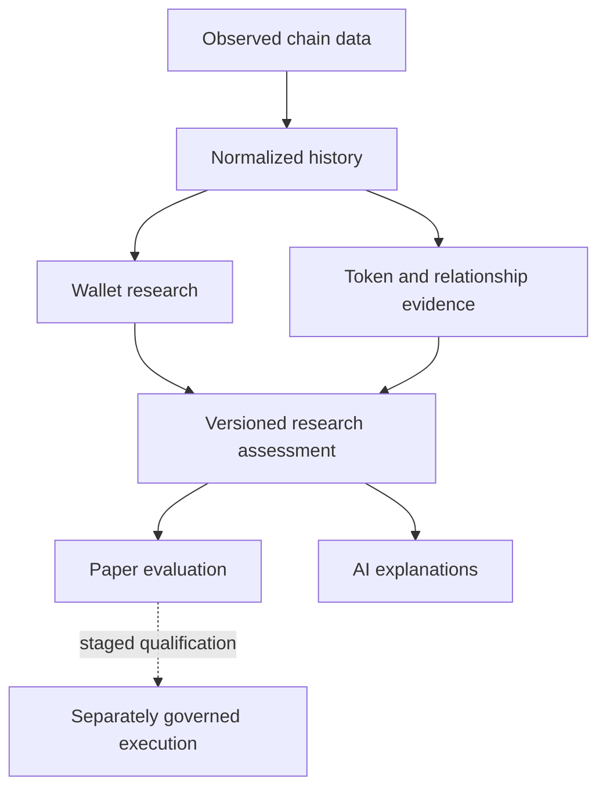

# Shadow

### Solana intelligence and staged agentic DeFi infrastructure

[Back to the ecosystem](../README.md)

Shadow is a standalone build for understanding repeatable on-chain behavior, assessing evidence and evaluating whether a trading idea remains viable under realistic execution conditions.

Its longer-term direction includes agentic research, simulation and tightly controlled execution. The intelligence engine remains independent of community rank, ecosystem holdings and marketing reputation.

## The problem

A profitable-looking wallet is not automatically a strategy that another participant can reproduce. Accounting coverage, sample quality, token risk, liquidity and execution costs all affect the conclusion.

Shadow separates those questions so one impressive score cannot hide missing evidence.

## A practical engineering scenario

A wallet appears profitable, but part of its history is missing and a copied trade would face different fees or liquidity. Treating the visible result as a ready-to-trade signal would hide the unanswered questions.

The research experience needs to distinguish observed activity, accounting coverage, repeatability, token risk and execution feasibility. AI can explain those findings; it must not convert missing evidence into confidence.

## Research and execution boundaries

This summarizes responsibilities represented in the build. The dotted relationship is staged development, not evidence of live autonomous execution.

## Decisions and tradeoffs

| Decision | Why it matters | Cost to manage |
| --- | --- | --- |
| Version evidence and analysis | Research can be compared and reproduced | Storage, provenance and compatibility need care |
| Surface incomplete coverage | An attractive score cannot conceal weak evidence | More uncertainty to communicate to users |
| Isolate paper evaluation from signing | Research experiments do not imply authority over capital | Execution needs its own qualification and infrastructure |
| Keep AI subordinate to evidence | Explanations cannot silently override risk judgments | Agent autonomy is deliberately constrained |

## Foundation represented in the repository

| Domain | Purpose |
| --- | --- |
| Ingestion and history | Durable processing, checkpointed backfills and duplicate handling |
| Wallet research | Reconstructed activity, versioned metrics and accounting limitations |
| Copyability | Evaluate whether observed behavior remains usable under execution costs |
| Token forensics | Distinguish observed facts, heuristic risk flags and unavailable evidence |
| Relationships | Research wallet connections without treating correlation as proven ownership |
| Research lifecycle | Preserve analysis provenance and auditable qualification decisions |

The repository contains API/worker infrastructure, database migrations and automated tests. Source review also confirms deterministic paper-execution primitives and restricted-canary signer-attempt validation, alongside broader evaluation, authorization and outcome-record modules.

These are implementation components, not proof of a deployed trading service. Paper simulation does not execute live orders; signer-attempt validation evaluates supplied evidence rather than demonstrating actual transaction signing.

A representative private-source safety test checks that the paper-execution module does not depend on signing or live transaction submission primitives. That source inspection supports the intended boundary; it is not a full dependency, custody or runtime security audit.

## Engineering decisions

- Keep evidence sources and canonical analysis distinct.
- Version research outputs so results can be reproduced and reviewed.
- Label missing data and weak samples explicitly.
- Keep product access separate from trading policy.
- Keep AI explanations subordinate to deterministic evidence and risk decisions.
- Separate intelligence from transaction custody and execution.

## Current stage and direction

The foundation includes wallet intelligence, copyability research and token forensics. Source-level development extends into paper evaluation and staged execution contracts; integration and operational verification remain separate.

The root documentation is not a current live-service audit. This showcase makes no claim of live autonomous trading, tested investment performance or completed production execution.

Future Oracle and Universe integration can provide identity and product experiences without taking control of Shadow's research judgments. Agent workflows and execution remain subject to their own implementation and release evidence.

## Technology

Python · API and background workers · PostgreSQL · Solana data integrations · automated tests

## Publication boundary

The showcase describes the engineering approach. Scoring formulas, strategy parameters, execution protocols, private portfolio information and operating configuration remain outside this page.
