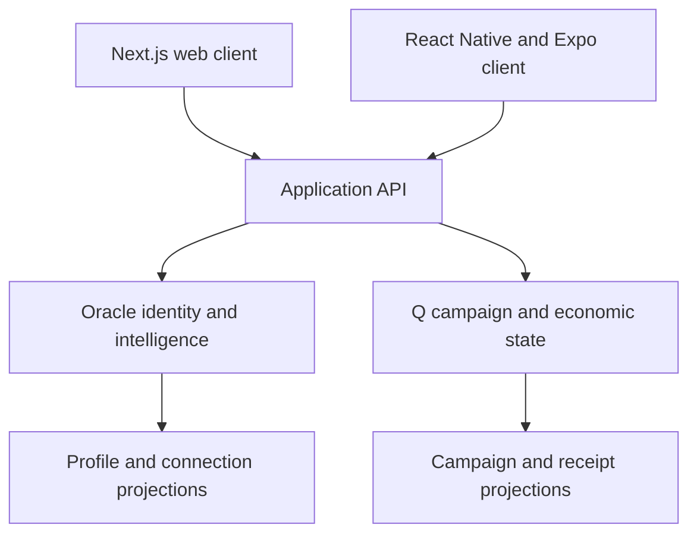

# CrabStar Universe

### One ecosystem across web and native mobile

[Back to the ecosystem](../README.md)

Universe is the unified application layer being built for CrabStar. It connects Universal Profiles, Oracle intelligence and community services, Project Q campaigns and rewards, and broader ecosystem experiences.

## The problem

Connected infrastructure is difficult to use when people must repeatedly switch tools, reconnect accounts and piece together their history.

Universe is intended to give those shared services one coherent experience while preserving their independent responsibilities.

## A practical engineering scenario

A member enters on mobile, returns on web, and has only some account connections verified. The application should preserve their canonical profile and show which experience is available next, without inventing eligibility or reward state.

The design challenge spans authentication continuity, platform-specific navigation and honest projections of services that may be incomplete or unavailable.

## Client and authority boundaries

This illustrates intended authority boundaries. It does not certify that every client-to-service path is integrated or deployed.

## Decisions and tradeoffs

| Decision | Why it matters | Cost to manage |
| --- | --- | --- |
| Share service contracts, retain distinct clients | Identity can remain consistent across devices | Web and native require separate validation |
| Present Oracle and Q state | The app avoids duplicating permanent identity and campaign authority | Service outages need clear interface states |
| Use platform-appropriate navigation | Mobile and desktop can fit their own interaction patterns | Design parity needs visual and behavioral review |

## Product direction

| Experience | Role |
| --- | --- |
| Universal Profile | Present persistent identity, connection state and reputation |
| Oracle | Make intelligence and assistance available across the application |
| Campaigns and rewards | Present Q participation, progress and economic receipts |
| Ecosystem discovery | Connect contribution, community and other product experiences |
| Multiple clients | Share identity and service contracts across web and mobile |

Oracle remains the authority for identity and reputation. Q remains the campaign/economic authority. Universe presents their state rather than creating a competing source of truth.

## Architecture direction

The approved client architecture uses Next.js for web/desktop and React Native with Expo for native mobile. Clients are intended to share API contracts, validation, identity types and design foundations while using platform-appropriate interfaces.

The native mobile direction includes iOS and Android clients. This is architectural intent, not a claim of App Store or Google Play availability.

## Engineering priorities

- Preserve account and contribution continuity across clients.
- Reuse backend services rather than duplicate business logic per interface.
- Keep privileged credentials out of client applications.
- Present partial connections, unavailable services and recovery steps clearly.
- Give desktop and native mobile their own appropriate interaction design.

## Current stage

Active application development and integration. The default branch contains separate Next.js web, Express/TypeScript API and React Native/Expo mobile packages, alongside home/native architecture specifications and mobile preview/visual-QA workflows.

Package presence and workflow definitions demonstrate build scope. Shared identity, intelligence and campaign journeys still require end-to-end verification.

Representative manifest review confirms Next.js/React for web and React Native/Expo for mobile. A shared-package extraction remains architecture direction rather than a completed monorepo claim.

This page does not certify deployment, store release or feature completeness.

## Publication boundary

Public material communicates experience, architecture and direction. Private service configuration, detailed identity recovery procedures and internal release blockers remain outside this showcase.
